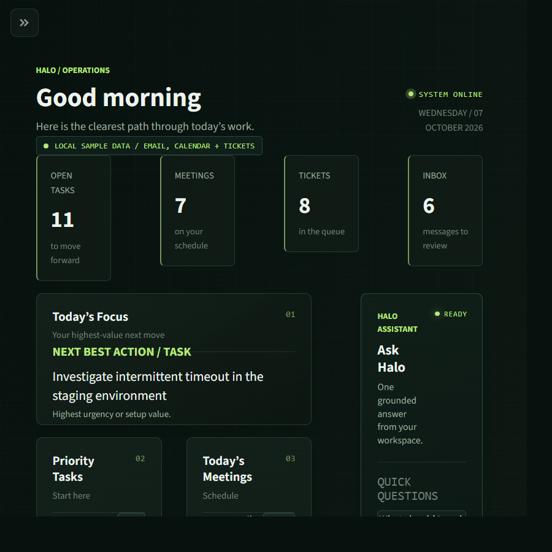
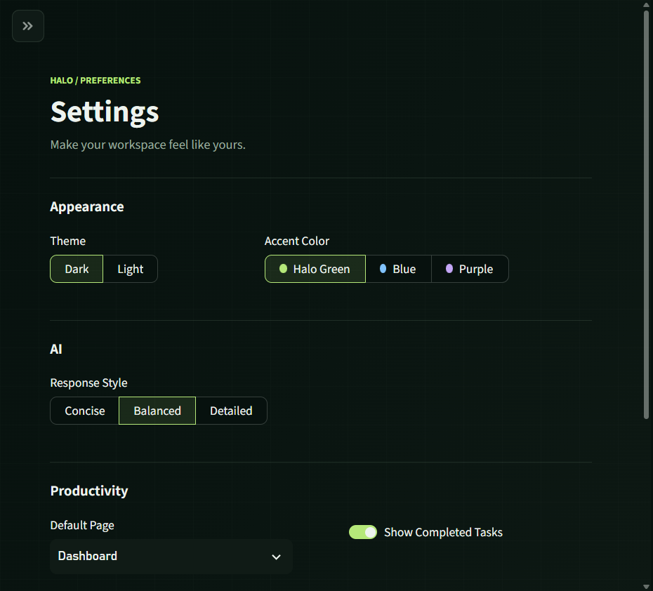
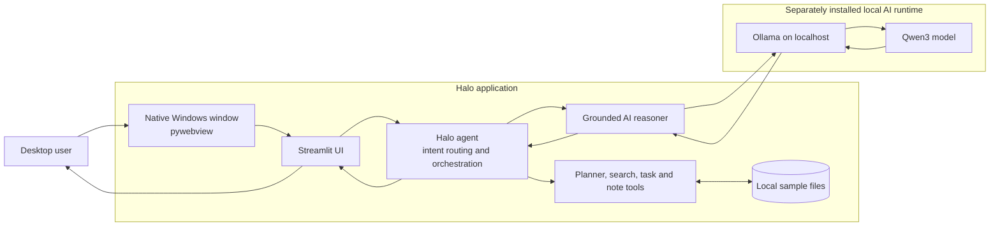

<p align="center">
  
</p>

<h1 align="center">Halo</h1>

<p align="center"><strong>A local-first desktop assistant for turning a busy workday into a clear next step.</strong></p>

<p align="center">Python · Streamlit · pywebview · Ollama · Qwen3</p>

## Overview

Halo is a single-user Windows desktop productivity assistant for interns and early-career engineers. It brings a task list, calendar, engineering queue, notes, sample inbox, daily planner, search, and an in-app AI assistant into one focused workspace.

Halo is designed to answer a practical question: **What should I work on next, and what context do I need?** Deterministic tools gather and rank local workspace information; a locally running language model can then explain or summarize those results.

The current portfolio build uses fictional sample data only. It does not connect to work accounts or external productivity systems, and it does not train or fine-tune the model.

## The Problem

Early-career engineers often spread daily work across task lists, meetings, tickets, notes, and inboxes. Switching between those sources makes it harder to see priorities and prepare for the next conversation.

Halo explores a desktop-first alternative: keep the workflow in one place, make the underlying data easy to inspect, and use AI as an explanation layer rather than as an autonomous decision-maker.

## Features

- **Mission Control dashboard:** Open tasks, meetings, tickets, inbox count, top focus, and a small in-app assistant.
- **Deterministic daily planning:** Rank tasks, meetings, and engineering work with transparent reasons.
- **Task lifecycle:** Review open tasks, explicitly confirm a completion, and see completed work.
- **Briefing:** Combine local task, schedule, ticket, and sample inbox context into a daily summary.
- **Search:** Find relevant items across sample tasks, calendar events, tickets, emails, completed tasks, and notes.
- **Local notes:** Save and search personal workspace notes stored in a simple text file.
- **Grounded AI assistance:** Ask questions about the supplied workspace context; AI can explain or summarize tool output.
- **Personal settings:** Choose dark or light theme, accent color, AI response style, default page, and completed-task visibility.
- **Native Windows desktop experience:** Move, resize, minimize, maximize, and restore the whole window using Windows controls.
- **Local-first operation:** Sample data stays in local files; AI requests go to the local Ollama service by default.

## Product Screens

### Mission Control

The dashboard puts the next best action beside the schedule, open work, and an assistant that can answer questions about the local workspace.



### Settings

Appearance, response style, and productivity preferences are grouped into four small sections and saved locally.



## Architecture



The desktop wrapper hosts the existing Streamlit application in a native Windows window. `HaloAgent` routes a request to deterministic tools, which read local task, calendar, ticket, email, and note files. For AI reasoning, Halo sends selected context to Ollama at `http://localhost:11434` by default and receives a text response. Ollama and Qwen3 are installed separately; they are not bundled in the Halo executable.

The planner remains authoritative for priority ordering. The model can explain the plan, but it does not replace tool results, change model weights, or take actions independently. Task completion requires an explicit user confirmation.

See [docs/ARCHITECTURE.md](docs/ARCHITECTURE.md) for component responsibilities, request flow, local state, and packaging details.

## Technologies

| Area | Technology | Role |
|---|---|---|
| Language | Python | Agent, tools, desktop launcher, and tests |
| Interface | Streamlit | Dashboard, forms, settings, and assistant UI |
| Windows shell | pywebview and WinForms/WebView2 | Hosts the app in a native, resizable desktop window |
| Local inference | Ollama and Qwen3 | Generate grounded explanations from local context |
| Packaging | PyInstaller, onedir | Builds `dist/Halo/Halo.exe` and required runtime assets |
| Tests | Python `unittest`, Streamlit `AppTest` | Validate agent behavior, AI client handling, preferences, and UI rendering |

## Design Decisions

- **Local files before infrastructure:** Plain-text sample files make the data flow inspectable and the project easy to run without accounts or external services.
- **Deterministic core, AI as a layer:** Intent routing and planner logic provide stable results; the model provides optional explanation and summarization.
- **Graceful AI fallback:** Halo still returns deterministic planning and briefing output when Ollama is unavailable.
- **One Python stack:** pywebview adds a native desktop host without introducing a separate JavaScript/Electron or Rust/Tauri application stack.
- **Native window controls:** Windows owns the frame and window-state behavior, while the existing Streamlit pages remain the product UI.
- **Explicit user action:** The assistant can recommend; state-changing task actions require user confirmation.
- **Sample-only product scope:** Fictional data gives reviewers and demo users a representative workflow without connecting to work systems.

## Engineering Challenges

- **Agent and model boundaries:** Keeping task lookup and priority decisions deterministic while still making AI summaries useful required a clear context contract and fallback path.
- **Local model latency and failures:** Inference on CPU can be slow. The client sets a request timeout, validates response shape, and returns a structured error so Halo can fall back to trusted local results.
- **Streamlit session behavior:** Widget state and chat history must survive reruns without losing user selections or duplicating messages.
- **Desktop packaging:** Streamlit relies on runtime assets and main-thread behavior. The frozen build launches a hidden server child process, bundles required resources, and keeps the visible window separate.
- **Native window behavior:** A browser page inside a desktop app does not automatically behave like a standard Windows window. The wrapper needed native frame behavior, taskbar identity, saved geometry, and work-area clamping.
- **Testing across layers:** Unit tests cover the agent and model client; Streamlit `AppTest` covers interactive settings; the packaged executable also needs a real startup/health check.
- **Product scope and trust:** Stable fictional examples, local-first defaults, explicit task confirmation, and clear status labels keep the demo understandable without implying that work systems are connected.

## Lessons Learned

- Establish one authoritative source for decisions; use AI to explain it, not silently override it.
- Design offline and failure paths as real product states, not exceptions to hide.
- Treat the packaged desktop executable as a separate runtime target; passing source tests alone does not prove the installed window starts.
- Keep sample data visible and inspectable while clearly separating it from user-authored local notes and task updates.
- Prefer small user-controlled actions over autonomous behavior when changing personal work state.

## Installation

### Prerequisites

- Windows 10 or later
- Python 3.13 (tested)
- [Ollama](https://ollama.com/) installed locally for AI responses

### Set up the project

```powershell
python -m venv .venv
.\.venv\Scripts\Activate.ps1
python -m pip install -r requirements.txt
ollama pull qwen3
```

Start Ollama, then run the desktop development launcher:

```powershell
python desktop\launcher.py
```

For the command-line experience:

```powershell
python src\main.py
```

For the Streamlit development server in a browser:

```powershell
streamlit run ui\app.py
```

To build the standalone Windows application folder:

```powershell
pyinstaller --noconfirm desktop\halo.spec
```

The complete onedir package is created under `dist\Halo`. Keep the executable with its supporting files.

## Usage

Try these example requests in the CLI or in the dashboard assistant:

```text
What is on my plate?
What should I prioritize?
Do I have meetings today?
Show engineering tickets
Give me a briefing
Plan my day
Find backend
Remember ask mentor about logging
Show notes
```

To change a task, open **Tasks**, choose the item, and confirm completion. Preferences are available under **Settings**. Sample tasks, meetings, tickets, and inbox records can be edited in the corresponding files in `data/`.

## Development and Tests

Run the complete test suite from the repository root:

```powershell
.\.venv\Scripts\python.exe -m unittest discover -s tests
```

The tests cover agent routing and actions, sample data behavior, local model response parsing, preference persistence, and desktop window state. The UI settings workflow is exercised with Streamlit `AppTest`.

## Roadmap

Halo’s next product steps focus on a stronger local workflow: selectable fictional scenarios, faster and cancellable AI responses, user-controlled backup/export, richer sample-work filters, accessibility improvements, signed Windows releases, and repeatable AI-quality evaluation. See [docs/ROADMAP.md](docs/ROADMAP.md) for the staged roadmap.

## Privacy and Scope

Halo currently uses fictional sample email, calendar, and ticket data plus local tasks and notes. It does not connect to work accounts or send data to a hosted AI service. AI prompts go to the configured Ollama endpoint; the default endpoint is local. If you change that endpoint to a remote service, prompt data would be sent there, so review that configuration before use.

The sample workspace is a portfolio/demo environment, not an approved system for confidential or production work data. The repository intentionally has no application account system, multi-user roles, audit-log pipeline, or dedicated prompt-injection defense.

## License

Halo is distributed under the [MIT License](LICENSE). The Ollama runtime and Qwen3 model are installed separately and retain their own applicable terms.
