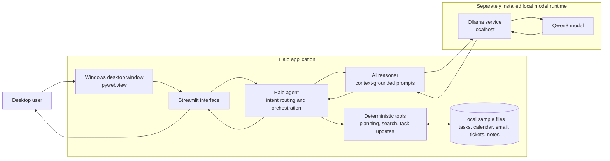

# Architecture

Halo is a local-first, single-user desktop application. The running product uses only the sample files shipped with the project; it does not connect to work accounts or external productivity systems.

## System view

`Ollama` and the Qwen3 model are installed separately on the desktop and are not bundled in Halo's installer. AI requests use the configured local Ollama endpoint, which defaults to `http://localhost:11434`.

## Request flow

1. The user submits a question in the Streamlit UI or command-line interface.
2. `src/tools/intent_router.py` maps supported phrases to an application intent.
3. `src/agent.py` selects the corresponding tool or builds a response from local context.
4. Deterministic tools read local files, update tasks or notes on explicit user requests, and construct planner output.
5. When AI reasoning is useful, `src/llm/reasoner.py` combines the question, existing tool output, and relevant sample context into a prompt.
6. `src/llm/ollama_client.py` sends the prompt to the local Ollama service and validates the returned text. If the service is unavailable, Halo returns a deterministic result or a clear fallback.
7. The UI renders the answer and keeps recent chat history in the active Streamlit session.

The model explains and summarizes application results; the deterministic planner remains authoritative for ordering work. Halo does not train or fine-tune the model.

## Data and state

| Data | Location | Purpose |
|---|---|---|
| Tasks and completed tasks | `data/tasks.txt`, `data/completed_tasks.txt` | Sample work queue and explicit completion updates |
| Calendar events | `data/calendar.txt` | Sample schedule used by the dashboard and planner |
| Emails | `data/emails.txt` | Sample inbox summaries |
| Engineering tickets | `data/engineering_tasks.txt` | Sample technical work items |
| Notes | `data/notes.txt` | User-created local notes |
| UI preferences | `%APPDATA%/Halo/preferences.json` on Windows | Theme, accent, response style, default page, and completed-task visibility |
| Window geometry | `%APPDATA%/Halo/window_state.json` on Windows | Native window size, position, and maximized state |

The sample files are ordinary local files. Halo does not provide application-level encryption or a multi-user authorization layer. Device access and file protections are provided by the operating system.

## Components

- `src/agent.py`: coordinates intents, data sources, tools, and optional AI reasoning.
- `src/tools/`: file-backed sample data readers, task and note actions, search, and planning.
- `src/llm/`: prompt construction, local Ollama requests, response validation, and fallbacks.
- `ui/`: Streamlit pages, controls, presentation components, and styling.
- `desktop/launcher.py`: starts the local Streamlit server and hosts it in a native Windows window.
- `desktop/halo.spec`: PyInstaller onedir packaging configuration.
- `tests/`: unit tests for agent behavior, AI client handling, preferences, and window state.

## Desktop packaging

The Windows wrapper starts a local Streamlit server on loopback and displays it through pywebview. A frozen build re-launches the executable in a hidden child process to host Streamlit on its required main thread. PyInstaller's onedir output includes Streamlit assets and Halo modules so the application can start without a browser tab.
